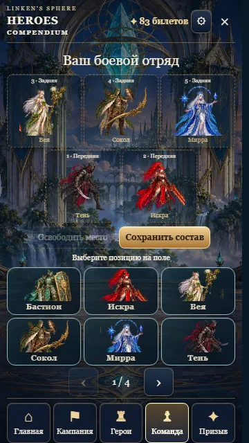
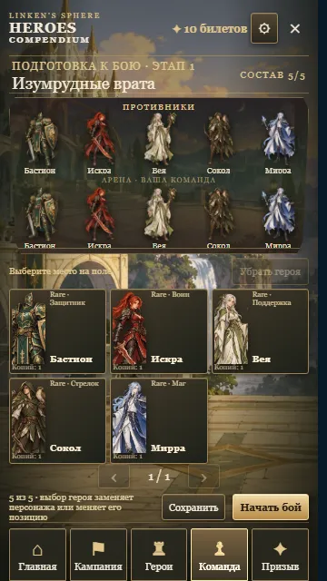
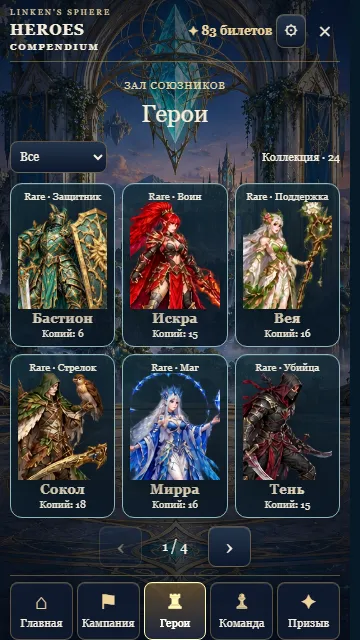
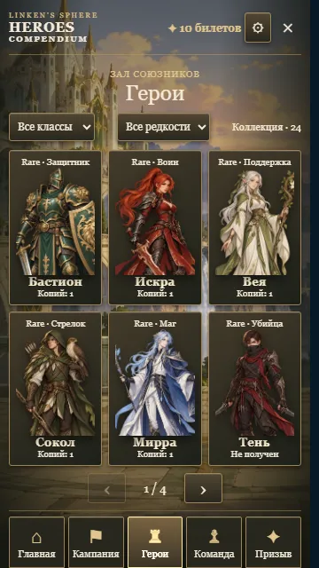
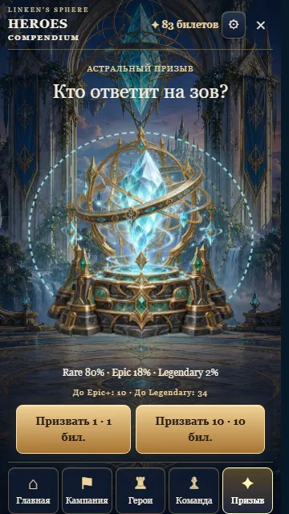
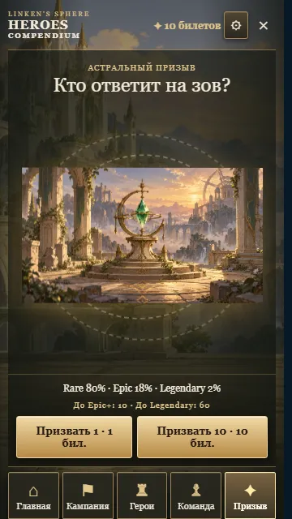
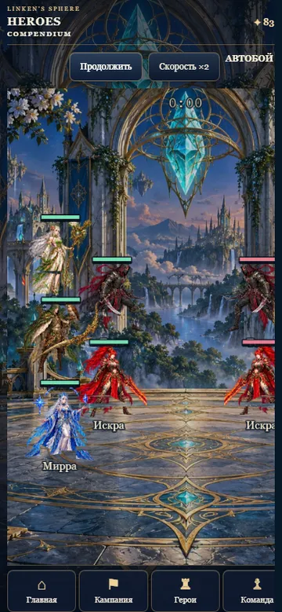
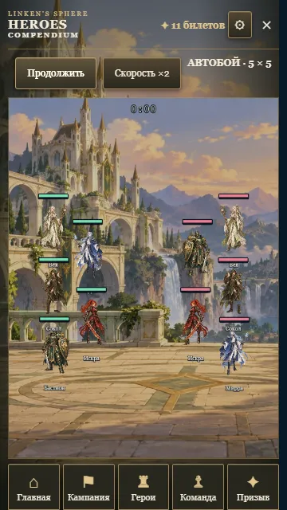

# Визуальный разбор MLA для Heroes Compendium

Дата исследования: 2 ноября 2026 года. MLA — референс композиции и игровых сценариев; изображения, персонажи, названия фракций, звуки и графика MLA в игру LSE не переносились.

## Что удалось проверить

- [Страница Mobile Legends: Adventure в Google Play](https://play.google.com/store/apps/details?id=com.moonton.mobilehero) не открылась в доступном просмотрщике (ошибка 404).
- [Галерея MWM](https://mwm.ai/apps/mobile-legends-adventure/1456213261) содержит снимки, отмеченные как изображения официальной страницы магазина. Сама карточка показывает метаданные версии 546, поэтому галерею нельзя считать подтверждением актуального интерфейса версии 2026 года.
- [Руководство BlueStacks по бою](https://www.bluestacks.com/blog/game-guides/mobile-legends-adventure/complete-guide-combat-mechanics-en.html) описывает состав из пяти героев, расстановки 2–2–1, 1–2–2 и 2–1–2, переднюю/заднюю линии и автоматическое использование способностей. Материал архивный; он использован как свидетельство принципов, а не текущей точной компоновки.
- [Руководство Wishing Shrine от Gamer Empire](https://gamerempire.net/mobile-legends-adventure-wishing-shrine/) опубликовано в 2022 году. Оно показывает отдельную сцену призыва и действия 1x/10x, но его сведения о старых шансах не использованы для изменения баланса LSE.
- [Снимок коллекции TechTudo, 2019](https://s2-techtudo.glbimg.com/ov_yAY-oqKHuM_-a4G3OTlTtwXs%3D/0x0%3A1280x720/984x0/smart/filters%3Astrip_icc%28%29/i.s3.glbimg.com/v1/AUTH_08fbf48bc0524877943fe86e43087e7a/internal_photos/bs/2019/B/V/ydY9TvQyOlboTYELiETg/screenshot-20190916-165336.jpg) и [снимок списка героев BlueStacks](https://cdn-www.bluestacks.com/bs-images/MLA_TheCompleteGuidetoCombatMechanics_S1.jpg) показывают галерейное представление с портретами и выбором персонажа.
- [Снимок боя Malavida](https://imag.malavida.com/mvimgbig/download-fs/mobile-legends-adventure-23819-1.jpg) показывает поле, команды лицом друг к другу и управляющие элементы скорости/авто.
- Нашёлся [ролик на Dailymotion](https://www.dailymotion.com/video/xa2j1vq), но он возвращает 410 Gone и не был просмотрен. Доступной свежей полной записи игрового процесса с экраном команды, коллекцией, призывом и боем получить не удалось. Поэтому в документе нет утверждений, что современные анимации MLA были изучены.

Прямые ссылки выше ведут к источникам или иллюстрациям. Референсные изображения не сохранены в репозитории и не используются как игровые ресурсы.

## Наблюдения по четырём экранам

### Команда перед боем

Пять персонажей должны восприниматься как состав на одном поле: видны ряды, соперник и контекст этапа. Это сокращает переходы между выбором персонажей и пониманием предстоящего боя. В Heroes Compendium игрок сначала выбирает позицию на сцене, затем героя; повторный выбор героя меняет его позицию с другим персонажем. На одном экране показаны модели обеих команд и компактный список собственных героев.

### Коллекция и профиль

В просмотренных галереях портреты занимают центральную часть карточки, а фильтры помогают находить героя. В LSE добавлены фильтры класса и редкости, компактные страницы по шесть персонажей, индикатор владения/копий и крупный профиль с переключением между героями. Статистика и описание способности разнесены по вкладкам.

### Wishing Shrine

Отдельная сцена призыва отделяет ожидание результата от управления коллекцией. Для LSE сохранены понятные действия одиночного и массового призыва, многофазная последовательность и раскрытие персонажа после анимации. Вероятности и серверное решение не менялись; старый сторонний гайд не использовался для корректировки игровых шансов.

### Автоматический бой

Материалы показывают одновременно обе команды на общей арене и отдельные средства управления темпом боя. В LSE поле, таймер, здоровье, энергия и эффекты строятся по событиям действующей серверной симуляции. Раскрытие изображения героя в полный рост помогает отделить визуальный слой от миниатюр старой сетки. Умения и расчёт наград остаются существующими игровыми событиями.

## Решения для LSE

- Использовать цельное поле и встречные команды при подготовке, а не пять разрозненных карточек.
- Сохранять точную выбранную позицию; обычные нажатия поддерживают добавление, удаление, замену и перестановку.
- Держать портрет героя главным элементом коллекции, а фильтры и подписи — компактными.
- Сделать профиль отдельной крупной сценой: обзор, характеристики, способность и переход к соседнему персонажу.
- Оставить призыв самостоятельным ритуальным экраном с одиночным/десятикратным действием; не раскрывать редкость до результата.
- В бою визуализировать текущие модели, здоровье, энергию, перемещения и события удара/умения, приходящие из текущей симуляции.
- Сохранить мобильную ориентацию, ограниченное игровое окно и отсутствие прокрутки страницы.

## Что не переносим

Не копируем арты, имена, иконки, музыку, кадры, тексты, конкретные декоративные элементы или точную раскладку MLA. Не переносим и старые проценты призыва. Ссылки выше служат исследовательскими свидетельствами композиционных решений, а не набором ресурсов или спецификацией пиксельного клона.

## Краткий Art Bible Heroes Compendium

**Направление.** Оригинальная стилизованная 2D RPG: читаемые силуэты и лица, иллюстративная линия, согласованная плотность деталей и мягкое направленное освещение. Персонажи нарисованы без текста и отдельных фоновых плашек.

**Палитра.** Основа — тёмный камень и лесные оттенки; панели и линии используют приглушённую бронзу и пергамент. Цвет редкости служит небольшим сигналом на рамке. Неон используется только внутри эффекта события и не определяет всю сцену.

**Персонажи и изображения.** Для карточек используется квадратный крупный портрет с лицом и плечами; для профиля, домашней сцены и арены — прозрачная фигура в полный рост. Все 24 игровых ID, роли, навыки и игровые данные сохранены. Поворот/размер боевых моделей общий, а узнаваемость создаётся силуэтом и цветом героя.

**Интерфейс.** Сцены имеют разные задачи и разные структуры, но используют общий набор камня, бронзы, читаемой типографики и компактных состояний выбора. В бою текст и панели не закрывают поле. Кнопки остаются достаточно крупными для касания.

**Движение.** Уже существующие idle-покачивание, движение конечностей, атака, попадание, применение умения, частицы, небольшая тряска камеры и короткая остановка сильного попадания связаны с временной шкалой боя. Новая анимация призыва использует несколько стадий ожидания и отдельное раскрытие результата. Это 2D-постановка из слоёв иллюстрации и визуальных эффектов, а не покадровая студийная анимация персонажей.

## Было и стало

| Экран | Было | Целевое изменение |
| --- | --- | --- |
| Команда | Слоты и список отдельно; соперник не виден; повторное размещение требовало ручного освобождения слота | Противник и команда находятся на общем поле; слот выбирается явно, герой ставится/заменяется/меняет позицию нажатием |
| Коллекция | Портреты из небольшого исходника, фильтр только по классу | Новые единые портреты и полнофигурные изображения, фильтры класса и редкости, отдельный профиль с вкладками |
| Призыв | Сцена с контрастом между старым фоном и стилизацией героев | Оригинальная вручную созданная для проекта иллюстрация святилища и сдержанная палитра, прежняя серверная механика |
| Бой | Сцена с маленькими/обрезанными существующими тайлами и фоновой композицией | Прозрачные модели в большем разрешении, полный силуэт, прежние события боя и эффекты, адаптированный размер отряда |

## Оригинальные игровые изображения

В проекте подготовлены 24 новых индивидуальных прозрачных иллюстрации героев, три тематических фона арен и оригинальный фон святилища. Они приведены к общему формату полного роста и отдельного портрета. Это иллюстрации, не покадровые модели: сложные жесты, детальная ручная анимация каждого персонажа и многоракурсные 3D-модели здесь не заявляются.

## Оставшаяся проверка

Проверку расположения на телефоне и компьютере, тесты интерфейса и доступность test/dev сайта фиксируем после сборки этой версии. Этот документ сам по себе не означает, что экраны проверены в браузере или обновление опубликовано.

## Сравнительные снимки экранов LSE

Снимки «до» сделаны из опубликованной до этой работы тестовой версии; «после» — из локальной сборки в Chromium на телефоне 360×640. Они показывают только собственную игру LSE, чужая графика в файлы не включалась.

| Экран | До | После |
| --- | --- | --- |
| Подготовка отряда |  |  |
| Коллекция |  |  |
| Призыв |  |  |
| Автобой |  |  |

Снимки экранов на широком мониторе: [подготовка отряда](heroes-compendium-review/after-team-desktop.webp), [коллекция](heroes-compendium-review/after-collection-desktop.webp), [призыв](heroes-compendium-review/after-summon-desktop.webp), [бой](heroes-compendium-review/after-battle-desktop.webp).

Проверка локальной сборки выполнена на 360×640 и 1366×768: страницы и сцены не требуют прокрутки; тест сценария проверил 24 героя, фильтр редкости, переход по трём вкладкам профиля, размещение/перестановку героя, сохранение состава, подготовку этапа, запуск боя, отображение результата и сокрытие героя до завершения призыва. Публикация и проверка самого тестового сайта фиксируются отдельно после штатной проверки GitHub.
